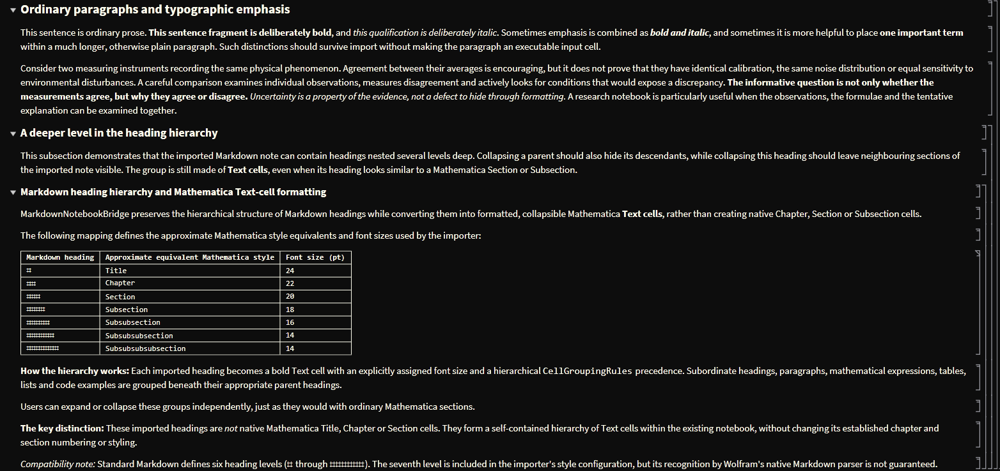
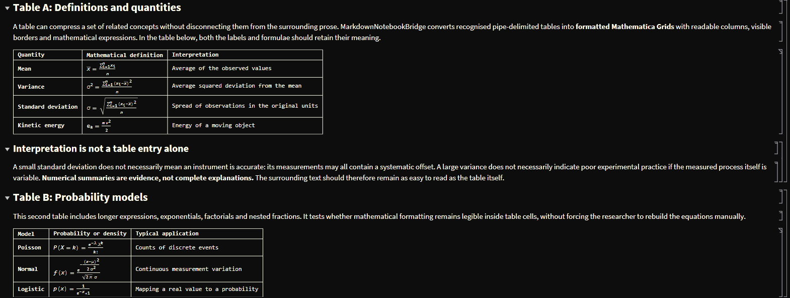

# MarkdownNotebookBridge

**Import Markdown as independently grouped research notes inside an existing Mathematica notebook.**

**Author:** Andre Elan · **GitHub:** [@reasonvoyager](https://github.com/reasonvoyager) · **Licence:** MIT · **Version:** 0.1.1 (initial public beta)

Tested with **Mathematica 15.0.1 on Windows**, including light and Dracula-themed notebooks, source-package and installed-paclet tests, and seven Wolfram Language regression tests (7/7 passed after correcting one test assertion). Other Wolfram Language versions and operating systems have not yet been verified.

## Why this exists

Markdown is an effective exchange format for ChatGPT and many other AI or research platforms. Mathematica notebooks are an excellent place to explore, calculate and retain research. But ordinary copy-and-paste into a Text cell leaves Markdown markers, TeX delimiters, code fences and tables to be repaired manually.

**MarkdownNotebookBridge** converts clipboard Markdown into *editable notebook cells at the current point of work*. Crucially, its Markdown headings become **collapsible, nested `"Text"` cells**, not new native `"Chapter"`, `"Section"` or `"Subsection"` cells. This keeps the notebook's existing section organisation and customised numbering separate from imported notes.

It builds on Wolfram's built-in `ImportString[..., {"Markdown", "Notebook"}]` rather than attempting to replace a full Markdown parser.

## Quick start — try it in a fresh Mathematica notebook

Want to see MarkdownNotebookBridge working? You can try it directly from Mathematica without downloading files manually, cloning a repository or using Git.
Requirements: Mathematica on Windows (tested with version 15.0.1).

1. Install and load the paclet
Open a new Mathematica notebook. Paste the following into an Input cell and evaluate it using Shift+Enter:

```wolfram
(* Install the public GitHub release *)

publicPaclet = PacletInstall[
  URL[
    "https://github.com/reasonvoyager/MarkdownNotebookBridge/releases/download/v0.1.1/MarkdownNotebookBridge-0.1.1.paclet"
  ]
];

(* Load the package *)

Needs["MarkdownNotebookBridge`"];
```
You only need to install the paclet once. In future Mathematica sessions, simply load it using Needs["MarkdownNotebookBridge"]`.

2. Prepare the import command
In a new Input cell, enter:

```wolfram
BridgeMarkdown[]
```
Do not evaluate it yet. Leave the cell ready for execution.

3. Copy this sample Markdown
Use the copy control on the following code block to copy the entire sample to your Windows clipboard:

```markdown
# Public Release Test
This is a **bold statement** and an *italic qualification*.

## Mathematical Expression

The Gaussian probability density is:
\[
f(x)=\frac{1}{\sigma\sqrt{2\pi}}e^{-\frac{(x-\mu)^2}{2\sigma^2}}
\]

## Table Test
| Quantity | Formula |
|---|---|
| **Mean** | \(\mu=\frac{1}{n}\sum_{i=1}^{n}x_i\) |
| **Variance** | \(\sigma^2=\frac{1}{n}\sum_{i=1}^{n}(x_i-\mu)^2\) |

```

4. Run the import
Return to Mathematica, select the Input cell containing BridgeMarkdown[], and press Shift+Enter.
That's it!
You should see the Markdown transformed into native Mathematica notebook content, including:
- Nested, collapsible heading groups using formatted Text cells.
- Bold and italic text.
- A typeset Gaussian probability density formula.
- A formatted table with mathematical expressions.
All content is inserted directly into your existing notebook. Imported headings do not interfere with your original notebook's section numbering or organisation.
What next?
Copy any Markdown from ChatGPT or another source and evaluate BridgeMarkdown[] again wherever you want to insert it.
For a more comprehensive example, see SampleMarkdown.md.
For alternative installation methods, source code, technical details and limitations, continue reading below.

## One-command use

Once installed:

```wolfram
Needs["MarkdownNotebookBridge`"];

(* Copy the Markdown source to the Windows clipboard, then evaluate: *)
BridgeMarkdown[]
```

Evaluate this in an **Input** cell of your destination notebook. The imported cells are inserted directly after that cell, respecting their Markdown order and creating expandable heading groups.

**Try the neutral scientific demonstration:** [`Examples/SampleMarkdown.md`](Examples/SampleMarkdown.md) explains the package whilst exercising nested headings, longer passages of scientific prose, differential equations, statistical and probability formulae, mathematical tables, numbered lists and non-evaluatable Wolfram Language code.

Copy the raw sample to the clipboard and run `BridgeMarkdown[]` in Mathematica to see its actual formatting and collapsible cell groups. The real Mathematica screenshots below show portions of that neutral scientific demonstration.

## What the imported result looks like

The screenshots below show actual Mathematica front-end output produced by importing the public demonstration file [`Examples/SampleMarkdown.md`](Examples/SampleMarkdown.md) with `BridgeMarkdown[]`.

### Nested heading hierarchy and formatted Text cells



This example shows the imported heading hierarchy, preserved bold and italic emphasis, and the mapping from Markdown heading levels to formatted Mathematica **Text cells**.

### Mathematical tables and readable Grid rendering



This example shows recognised Markdown tables rendered as readable Mathematica **Grid** cells, including typeset mathematical expressions inside table entries.

## Capabilities

| Markdown input | Imported notebook content |
|---|---|
| Headings `#` ... `######` | Bold, hierarchical **Text** cells; collapsible cell groups |
| Ordinary paragraphs, `**bold**`, `*italic*` | Readable Text cells with preserved emphasis |
| `\(...\)` and `\[...\]` | Typeset inline and display mathematics |
| Pipe tables, including inline TeX | Formatted **Grid** cells (not narrow native Tabular displays) |
| Numbered lists | Grouped list cells; separate lists restart at 1 |
| Fenced code blocks | **Code** cells with `Evaluatable -> False` |
| Markdown hyperlinks | Delegated to Wolfram's native Markdown importer; link behaviour may depend on the front end |

The importer currently recognises the six standard Markdown heading levels. Internally, the style mapping also includes a seventh heading specification, but seventh-level Markdown recognition is not guaranteed by the native parser.

### Heading appearance

| Markdown level | Approximate Mathematica equivalent | Font size |
|---|---|---:|
| `#` | Title | 24 pt |
| `##` | Chapter | 22 pt |
| `###` | Section | 20 pt |
| `####` | Subsection | 18 pt |
| `#####` | Subsubsection | 16 pt |
| `######` | Subsubsubsection | 14 pt |

**These are all rendered as `"Text"` cells**, not the native heading styles listed for comparison.

## Alternative installation methods

### Recommended: prebuilt paclet from GitHub Releases

Download `MarkdownNotebookBridge-0.1.1.paclet` from its GitHub release assets, then run:

```wolfram
PacletInstall[File["C:\\path\\to\\MarkdownNotebookBridge-0.1.1.paclet"]];
Needs["MarkdownNotebookBridge`"];
BridgeMarkdown[]
```

**Note:** The separate `.paclet` file is built using Wolfram's `PacletBuild`. A source ZIP is **not** interchangeable with the `.paclet` archive. The public binary release asset must be supplied from a Wolfram-built archive; it is not embedded in this source repository.

### Use or build from source

Clone or download the repository, then point `pacletRoot` to the directory containing `PacletInfo.wl`:

```wolfram
pacletRoot = "C:\\path\\to\\MarkdownNotebookBridge";
PacletDirectoryLoad[pacletRoot];
Needs["MarkdownNotebookBridge`"];
```

To build a distributable archive:

```wolfram
Needs["PacletTools`"];
buildResult = PacletBuild[pacletRoot];
pacletArchive = buildResult["PacletArchive"];
```

Run the tests before publishing any locally built archive:

```wolfram
TestReport[
  FileNameJoin[{pacletRoot, "Tests", "ImporterTests.wlt"}]
]
```

## Public API

```wolfram
BridgeMarkdown[]                      (* Primary clipboard command *)
InsertMarkdownFromClipboard[]        (* Backwards-compatible alias *)
MarkdownToNotebookCells[markdown]    (* String -> list of Cell expressions *)
RenderMarkdownTable[tableMarkdown]   (* String -> formatted Grid *)
RenderMarkdownTableFromClipboard[]   (* Clipboard table -> Grid *)
```

Both clipboard insertion commands accept the option `"HeadingMode" -> "Text"` (the default). The string conversion and table rendering functions can be used independently of the Windows clipboard.

## Try the self-demonstrating sample

`Examples/SampleMarkdown.md` explains why this package exists *while exercising its features*. It includes long paragraphs, formatted emphasis, labelled links, nested headings, complex TeX and **two mathematical Markdown tables plus one heading-level reference table**, separate numbered lists and a fenced Wolfram Language code example.

Read and render it without modifying any notebook:

```wolfram
sample = Import[
  FileNameJoin[{pacletRoot, "Examples", "SampleMarkdown.md"}],
  "Text"
];
NotebookPut[
  Notebook[
    MarkdownToNotebookCells[sample],
    CellGrouping -> Automatic
  ]
]
```

For the actual clipboard workflow, copy the *raw Markdown source* from the file and evaluate `BridgeMarkdown[]` in a notebook Input cell.

## Compatibility, known limitations and safety

- **Tested environment:** Windows, Mathematica 15.0.1. Clipboard reading currently calls PowerShell `Get-Clipboard -Raw`.
- Affected notebook themes may show **poor contrast in `"Code"` cells with `Evaluatable -> False`**, especially light themes. This is a front-end style issue observed in manual testing, not a failure of the Markdown parser. The option is retained deliberately so reference code is non-evaluatable by default but can be enabled through **Cell → Cell Properties → Evaluatable**.
- Markdown tables currently expect ordinary pipe separators. Complex escaped pipes, nested tables, and advanced TeX environments may not be handled correctly.
- Inline mathematical rendering is based on supported TeX conventions and the existing specialised Grid renderer, not a complete LaTeX implementation.
- The package is intended for **trusted Markdown inputs**. Review unfamiliar content before importing it into a computational notebook.
- The reverse Mathematica-to-Markdown exporter is **not part of this project**; it is a possible separate future tool.

## Repository contents

- `Kernel/MarkdownNotebookBridge.wl`: the consolidated v6 import and table-rendering implementation, with public wrappers.
- `PacletInfo.wl`: paclet metadata.
- `Tests/ImporterTests.wlt`: seven kernel regression tests.
- `Examples/SampleMarkdown.md`: expanded manual demonstration and acceptance test.
- `docs/images/`: authentic Mathematica screenshots from the neutral scientific demonstration.
- `CHANGELOG.md`, `LICENSE`, `BuildPaclet.wl`: release history, MIT licence and build helper.

## Author, feedback and licence

**Andre Elan** · [ReasonVoyager on GitHub](https://github.com/reasonvoyager)

Copyright © 2026 Andre Elan. Distributed under the [MIT licence](LICENSE).

Please submit issues and improvement suggestions through GitHub Issues after the repository is published. Contributions are welcome, particularly platform testing, front-end theme fixes and Markdown edge cases.

### Wolfram Community discussion

I've introduced MarkdownNotebookBridge on [Wolfram Community](https://community.wolfram.com/t/import-markdown-into-existing-mathematica-notebooks-without-changing-their-section-structure/28349).

If you try the paclet, I'd welcome hearing how it works in your Mathematica environment, particularly with different notebook themes, Wolfram Language versions or operating systems.

For reproducible bugs and proposed improvements, please use [GitHub Issues](https://github.com/reasonvoyager/MarkdownNotebookBridge/issues).

## Wolfram reference

- [Markdown import format](https://reference.wolfram.com/language/ref/format/Markdown.html)
- [Creating paclets](https://reference.wolfram.com/language/PacletTools/tutorial/CreatingPaclets.html)
- [CellGroupingRules](https://reference.wolfram.com/language/ref/CellGroupingRules.html)
- [CounterAssignments](https://reference.wolfram.com/language/ref/CounterAssignments.html)
